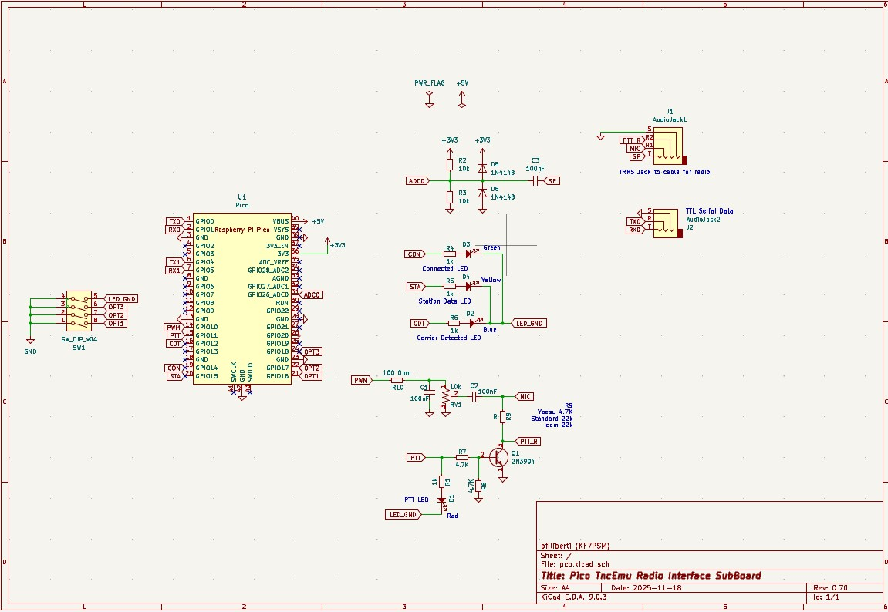

# Pocket Pico TNC (HF)

PICO TNC aka (Pocket Pico) is the Terminal Node Controler for Amateur Packet Radio powered by Raspberry Pi Pico. This is a fork of that project. We have removed all of the major features of the code for the original 1200bps version and added modulator/demodulator for 300bps hf operation and maintained the z80 emulator from my TNCEMU project that emulates a Heathkit HK21 Pocket Packet. Introductory Video can be seen here: https://youtu.be/zq6JLoosqGQ


NOTICE: This HF Version is still experimental use at your own risk!

## PICO TNC features

- Encode and decode Bell 202 AFSK signal without modem chip
- Multiple Demodulators (7) spaced 50hz apart for better receive capture (stations up to about 180hz off tune)
- Support USB Serial as well as 3.3v ttl serial interface
- Emulated Support of full tnc and tnc commands including pbbs
- Kiss support at the flip of a switch.
- Operates with open squelch
- TTL Serial Port is configured by emulated TNC parameters when used as a console port.

## Todo
- Investigate if FX.25 can be added especially for hf.


## How to build
```
git clone https://github.com/pfiliberti/pico_tnc.git
cd pico_tnc
mkdir build
cd build
cmake ..
make -j4
(flash 'pico_tnc/pico_tnc.uf2' file to your Pico)
```
## Building with Docker
```
git clone https://github.com/pfiliberti/pico_tnc.git
cd pico_tnc
docker build -t pico-builder .
docker run -it --rm -v "$PWD:/vagrant" -w /vagrant pico-builder
mkdir -p build
cd build
cmake ..
make -j4
(flash 'pico_tnc/pico_tnc.uf2' file to your Pico)
```


[](schematic.png)
